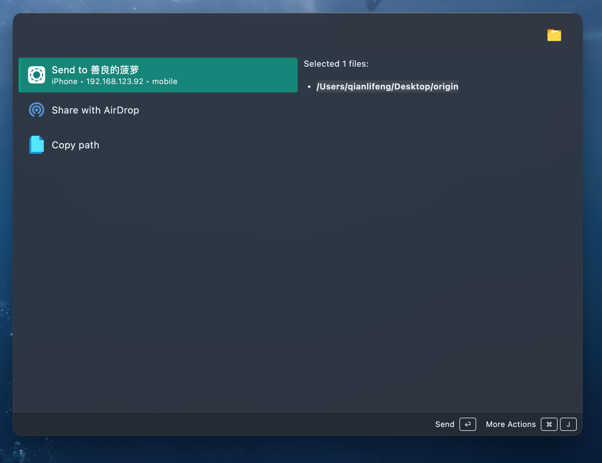

# Wox.Plugin.LocalSend

A Wox plugin to send files via LocalSend protocol.

## Features

- Send files to LocalSend devices.

## Installation

`wpm install localsend`

## Usage

Enter `send` followed by a space in Wox to see discovered LocalSend devices. The plugin listens for device announcements, scans in the background at startup and approximately every minute, and refreshes when you open the list. Cached devices are shown immediately and expire after two minutes without being rediscovered.

To send files, select them in your file manager and use Wox's selection hotkey, then choose a device from the results.

When enabled, the plugin also advertises `Wox - <computer name>` as a LocalSend receiver. Incoming files are accepted automatically and saved in a separate folder for each transfer under `~/Downloads/LocalSend`; existing files are never overwritten. This uses HTTPS, but any reachable LocalSend sender can send files without approval. The receiver stops when the plugin is disabled or unloaded.

Enter `receive` followed by a space to view received transfers. Each result represents one transfer; press Enter to open its folder. The folder contains the metadata used for history. Deleting a transfer folder removes it from the list. Records from earlier versions are not migrated.
